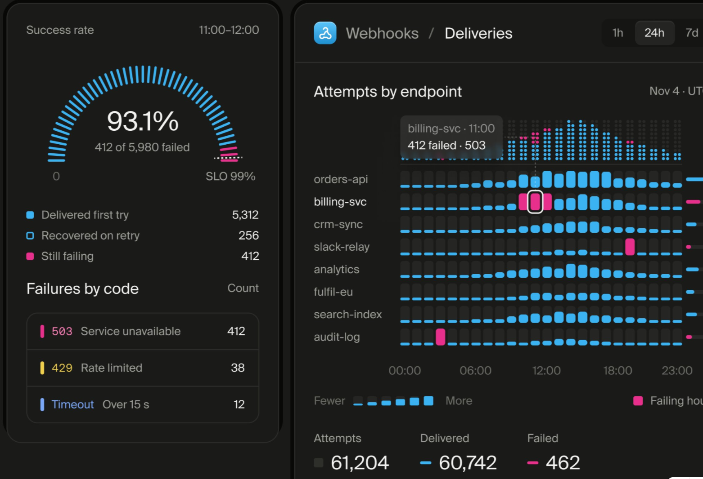
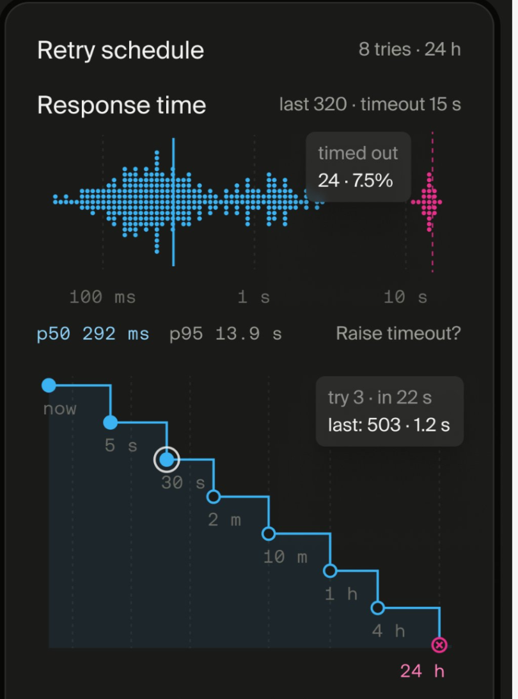
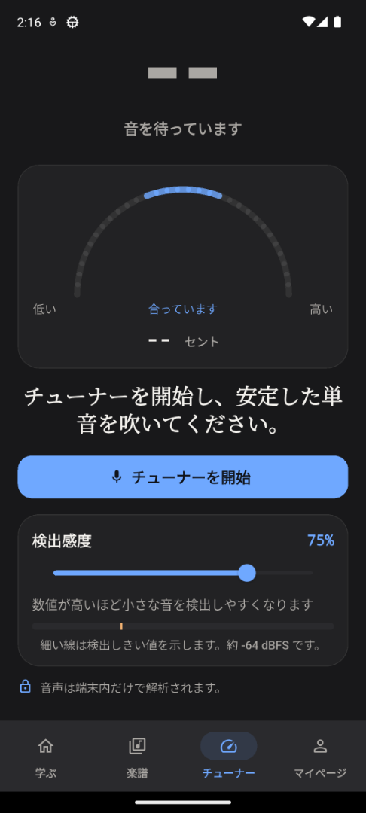

# Design QA

## Practice Screen

### Evidence

- Design source: `qa/figma-practice-target.png`
- Android implementation: `qa/practice-final.png`
- Side-by-side comparison: `qa/practice-comparison-final.png`
- Device profile: Pixel 6 emulator, Android 13 / API 33
- Captured viewport: 1080 x 2400 px
- Compared state: Chinese, light theme, microphone idle

| Image | Pixel size |
| --- | --- |
| Figma target | 689 x 1364 |
| Android implementation | 1080 x 2400 |
| Side-by-side comparison | 2168 x 2400 |

### Required Fidelity Surfaces

- Compact lesson app bar with back and overflow actions
- Three-stage lesson progress
- Opposed target label and harmonica tab label
- Large centered target note and breathing instruction
- Ten-hole harmonica diagram with the active hole highlighted
- Upcoming-note strip with active-note state
- One compact guidance surface
- Bottom tonal control dock with speed, primary action, and loop controls
- Figma light-theme color, typography, spacing, radius, and hierarchy

The Android implementation uses functional note data in the upcoming-note strip.
The Figma reference contains decorative repeated values in that area, so exact
digit matching is not required for product behavior.

### Comparison History

The first implementation differed from the reference in these visible areas:

- The note label used `F5` instead of `F`.
- The speed label used `1.0x` instead of `1x`.
- The note, stage indicator, guidance surface, and bottom dock were oversized.
- The short breathing instruction was repeated in the guidance surface.
- Vertical whitespace did not follow the reference hierarchy.

The final comparison confirms that these differences were corrected while
keeping the microphone, guide tone, speed, loop, haptics, and lesson completion
controls functional.

### Result

Practice screen result: passed

## Charts and Dark Theme

### References

- Dark dashboard reference: `qa/chart-reference-dark-dashboard.png`
- Dot distribution reference: `qa/chart-reference-dot-distribution.png`
- Android tuner evidence: `qa/tuner-dark-ja-120.png`
- Device profile: Pixel 6 emulator, Android 13 / API 33
- Captured state: Japanese, dark theme, 120% text size, 75% sensitivity, microphone idle

### Verified Product Decisions

- The tuner uses a segmented pitch arc instead of a thin pointer scale.
- Pitch spread uses stacked dots binned by cents; the chart has one main data color and one amber deviation color.
- The seven-day weak-note heatmap uses real local pitch attempts only.
- Numeric chart values, sensitivity, cents, and dBFS values use monospace type.
- Dark mode uses neutral charcoal backgrounds and surfaces:
  - background `#18181A`
  - surface `#222224`
  - primary `#6FA8FF`
  - amber `#F2B272`
- Magenta remains reserved for errors.
- The tuner scroll keeps the local-audio privacy line clear of the bottom navigation at 120% text.

### Device Checks

- Japanese Lesson 2 Practice rendered without truncation in dark mode.
- Japanese tuner copy rendered without truncation at 120% text.
- Dark tuner showed the segmented arc, `75%` sensitivity, `入力レベル 0%`, and `約 -64 dBFS`.
- Sensitivity persisted at `75%` after the earlier change.
- Reduced motion was enabled in the profile summary.
- The microphone start/stop lifecycle was verified separately on the installed APK. Real pitch accuracy is unverified because no known-frequency audio was injected.

Charts and dark theme result: passed

final result: passed
