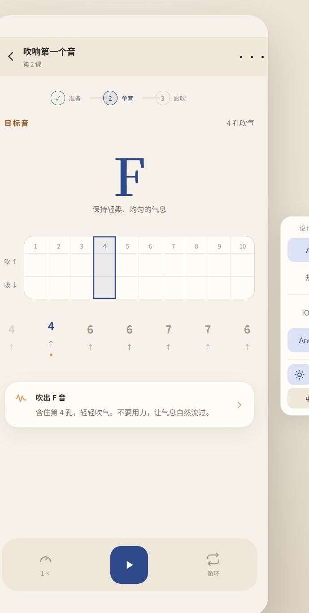
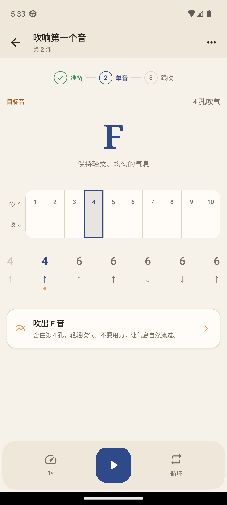
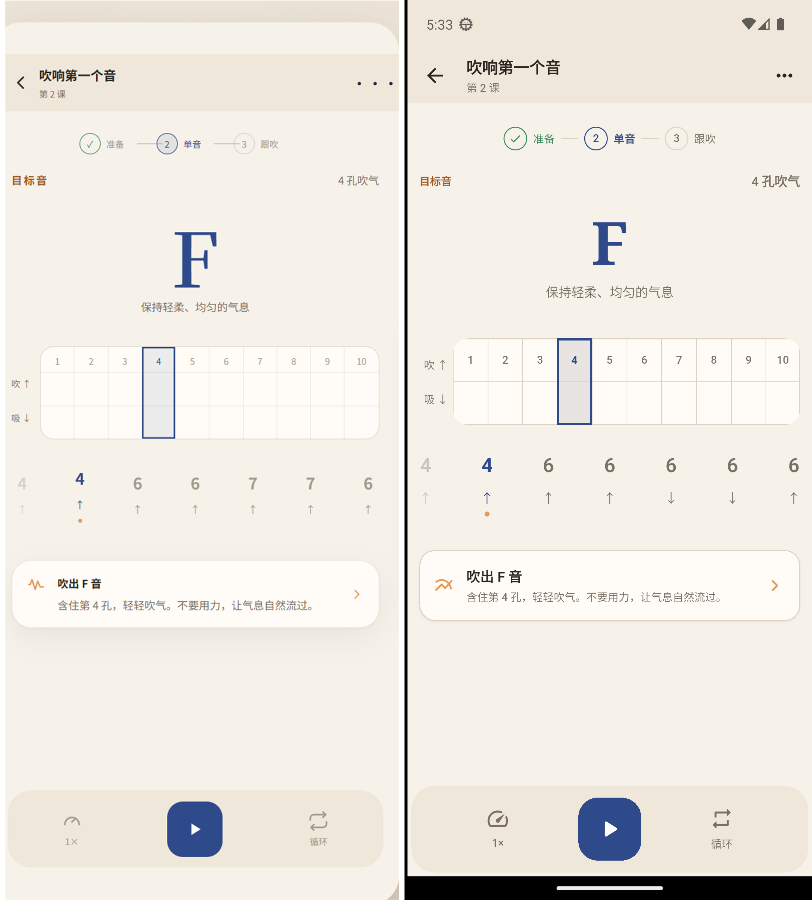

# Practice Screen Design QA

## Evidence

- Design source: `qa/figma-practice-target.png`
- Android implementation: `qa/practice-final.png`
- Side-by-side comparison: `qa/practice-comparison-final.png`
- Device profile: Pixel 6 emulator, Android 13 / API 33
- Captured viewport: 1080 x 2400 px
- Compared state: Chinese, light theme, microphone idle

| Image | Pixel size |
| --- | --- |
| Figma target | 689 x 1364 |
| Android implementation | 1080 x 2400 |
| Side-by-side comparison | 2168 x 2400 |

## Required Fidelity Surfaces

- Compact lesson app bar with back and overflow actions
- Three-stage lesson progress
- Opposed target label and harmonica tab label
- Large centered target note and breathing instruction
- Ten-hole harmonica diagram with the active hole highlighted
- Upcoming-note strip with active-note state
- One compact guidance surface
- Bottom tonal control dock with speed, primary action, and loop controls
- Figma light-theme color, typography, spacing, radius, and hierarchy

The Android implementation uses functional note data in the upcoming-note strip.
The Figma reference contains decorative repeated values in that area, so exact
digit matching is not required for product behavior.

## Comparison History

The first implementation differed from the reference in these visible areas:

- The note label used `F5` instead of `F`.
- The speed label used `1.0x` instead of `1x`.
- The note, stage indicator, guidance surface, and bottom dock were oversized.
- The short breathing instruction was repeated in the guidance surface.
- Vertical whitespace did not follow the reference hierarchy.

The final comparison confirms that these differences were corrected while
keeping the microphone, guide tone, speed, loop, haptics, and lesson completion
controls functional.

## Result

final result: passed
